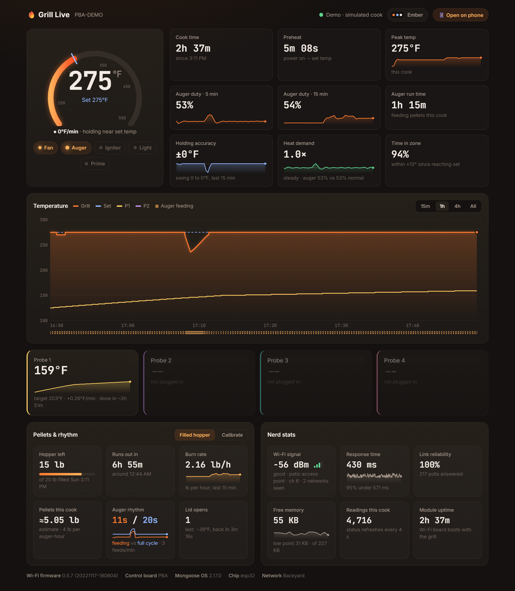
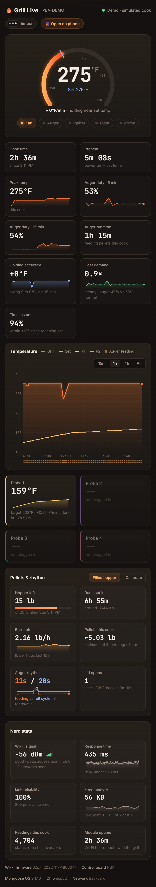
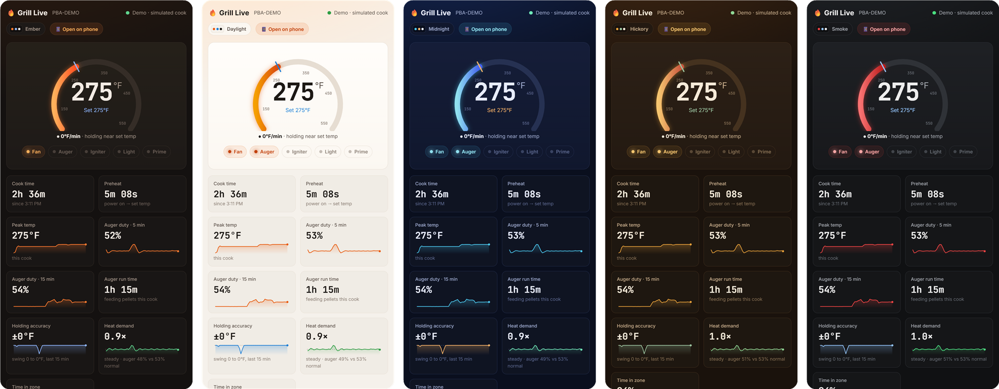

# Grill Live 🔥

**A live dashboard for Pit Boss Wi-Fi pellet grills that runs on your own computer.** It reads the grill straight off your home network, so there's no cloud, no account and no app needed. Open it on your phone while you cook.



> Unofficial community project. Not affiliated with or endorsed by Dansons or Pit Boss.

## What you get

- **Grill temperature:** a live gauge with the set temp, heat rate (°F/min) and a countdown to the set temp
- **Meat probes:** up to 4, each with its target, how fast it's rising and an estimated done time
- **Live parts:** fan, auger, igniter, light and primer, lit up while they run
- **Chart:** grill, set and probe temps over 15 min, 1 h, 4 h or the whole cook, with a strip marking every pellet feed
- **Cook stats:** cook time, preheat time, peak temp, holding accuracy (±°F and swing) and time in zone (within ±10° of set)
- **Pellets:** burn rate, pounds burned this cook and a **hopper countdown** that says when you'll run out
- **Heat demand:** how hard the auger is working compared with its normal pace at your set temp. It catches heat loss from an open lid, cold food or wind before the temperature shows it
- **Auger rhythm:** how long each feed lasts against the full feed cycle, plus duty over the last 5 and 15 minutes
- **Sparklines:** small trend lines on the main cards, so you can see where each number has been, not just where it is
- **Lid-open detection:** each sudden drop at a steady set temp, how far it fell and how long it took to recover
- **Nerd stats:** the grill's Wi-Fi signal (dBm) and which access point it's on, response time, link reliability and ESP32 free memory
- **Themes:** Ember, Daylight (high contrast for bright sun), Midnight, Hickory and Smoke, or match your phone's light or dark mode. Each phone remembers its own pick
- **Logging:** every reading goes to a daily CSV in `logs/`, so each cook is kept



### Themes

Pick one from the **Theme** menu in the top corner: Ember, Daylight, Midnight, Hickory or Smoke. **Match system** follows your device's light or dark mode.



## Quick start

You need Python 3.8 or newer. There's nothing else to install.

```bash
git clone https://github.com/ItsFlipppp/grill-live.git
cd grill-live
python server.py
```

Switch the grill on first. With no address given, Grill Live searches your network for the grill (one quick request per address) and remembers it for next time.

**On your phone:** scan the QR code that appears in the terminal with your phone's camera. On your computer, open **http://localhost:8880** and tap **Open on phone** for the same code. Your phone just needs to be on the same Wi-Fi. Once it's open, use **Add to Home Screen** to keep it one tap away.

> The first time you run it, Windows or macOS may ask whether Python can accept connections on your network. Click **Allow** (private networks), or your phone won't be able to connect.

**No grill handy?** `python server.py --demo` runs a simulated 2½-hour cook.

| Option | What it does |
|---|---|
| `--grill 192.168.1.50` | Use this address and skip the search |
| `--local-only` | Only this computer can open the dashboard (no phone access) |
| `--port 8880` | Dashboard port |
| `--interval 2` | Seconds between readings. The grill only refreshes every 2 seconds, so going lower gains nothing |
| `--board PBV` | Force a control-board layout (see below) |
| `--no-wifi-scan` | Skip the Wi-Fi signal scan the grill runs every 10 minutes |
| `--demo` | Simulated cook, no grill needed |

## Pellet estimates

The grill doesn't weigh pellets. Grill Live times how long the auger runs and multiplies that by a feed rate, **4 lb per hour of auger running** by default.

- **Hopper countdown:** tap **Filled hopper** and enter how many pounds you loaded.
- **Calibrate:** after a cook, divide the pounds you actually used by the auger run time (in hours, shown on the dashboard) and enter that under **Calibrate**. Your estimates get more accurate from then on.

## Supported grills

The grill's Wi-Fi module reports a control-board name such as `PBA`. Grill Live reads that name and picks the matching data layout.

| Board | Layout | Status |
|---|---|---|
| PBA (PB1150PS3, PB1250CS2, PB1250NX, PB1250PL, PB1300M, PB1300PS4, PB1600CS2, PB1600M, PB1600PS3) | A | ✅ Tested |
| PBB, PBD, PBE, PBT | A | Should work |
| PBC, PBC2, PBG, PBV, PBV2, PBL, PBL2, PBL3, PBP | B | Should work |
| LBL, LFS | L | Should work |
| PBM, PBM2 | M | Should work |
| PBVA | VA | Should work |
| PBX1 | Different protocol | ❌ Not supported |

**Have one of the untested grills?** Open `http://localhost:8880/api/raw` while it's cooking and paste the output into an issue, along with what the grill's own display shows. That's enough to confirm a layout or fix it.

## How it works

The Wi-Fi board in these grills is an ESP32 running Mongoose OS. It sits on a serial line to the grill's controller, asks for a status report every 2 seconds, and answers JSON-RPC requests on port 80 of your network. Grill Live only uses read-only calls:

- `PB.GetState` returns the two latest reports as hex. `FE0C…` holds temperatures (each one 3 bytes of decimal digits, with `960` meaning no probe). `FE0B…` holds the power, fan, auger, igniter and error flags.
- `Sys.GetInfo` returns uptime, memory and the board name.
- `PBL.StartWifiScan` runs every 10 minutes, for signal strength.

It never sends commands to the grill. It answers in roughly 0.4 to 2 seconds per request, because the firmware builds every reply in a small built-in script interpreter.

**Why the temperature sits on the set point:** while the grill is holding near its set temperature, the controller reports exactly the set temperature. Small swings, and the first part of a lid opening, never show up in the reading. The controller still feeds pellets based on the real temperature, so Heat demand watches the auger instead. Bigger swings do show in the temperature.

**Go easy on it.** The ESP32 has very little memory. Aggressive port scans or rapid-fire requests can reboot the Wi-Fi board. The grill keeps cooking, but the app loses its connection while it restarts.

## Security note

The grill's local interface has **no authentication**. Anything on your Wi-Fi can read it and send it commands, not just this dashboard. The simplest protection is to put the grill on a guest or IoT Wi-Fi network, separate from your computers and phones. If you do, run Grill Live on a machine that can reach that network.

## Privacy

Everything stays on your machine. Readings go to `logs/YYYY-MM-DD.csv` and your hopper and calibration settings to `settings.json`. Both are git-ignored. The dashboard page loads two fonts from Google Fonts, and that's the only outside request.

## Tests

```bash
python -m unittest discover -s tests
```

## Credits

The protocol and the per-board layouts come from [pytboss](https://github.com/dknowles2/pytboss) by David Knowles (Apache-2.0), the Python library behind the Home Assistant Pit Boss integration. The built-in QR code generator (`qr.py`) follows the structure of [Project Nayuki's QR Code generator](https://www.nayuki.io/page/qr-code-generator-library).

## License

MIT. Pit Boss is a trademark of Dansons Inc.
